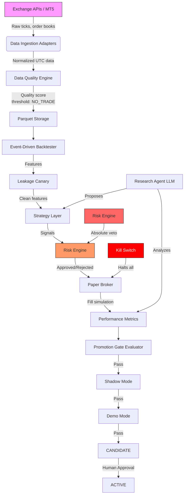

# Phase 0: Architecture Analysis & Execution Plan

**Project**: Autonomous Quantitative Research Lab with Demo/Paper Execution
**Date**: 2026-09-20
**Environment**: Windows 10, Intel CPU, Python 3.11.15 (needs upgrade to 3.12+), 367 GB free, Docker ✅

---

## 1a. ARCHITECTURE ANALYSIS

### Current State: EMPTY REPOSITORY

The repository at `C:\Users\<USER>\quant-lab\` has been created with directory structure only. No source code exists yet.

### Target Architecture: Modular Monolith

```
quant-lab/
├── AGENTS.md              # Standing rules (Part A)
├── configs/               # Typed config (YAML + .env)
│   ├── config.yaml        # Main config
│   └── promotion.yaml     # Gate thresholds
├── libs/
│   └── quant_math/        # Phase 3B: E1-E11 pure functions
│       ├── __init__.py
│       ├── volatility.py    # E1
│       ├── trend.py         # E2
│       ├── mean_reversion.py # E3
│       ├── cross_asset.py   # E4
│       ├── microstructure.py # E5
│       ├── execution.py     # E6
│       ├── risk.py          # E7
│       ├── statistics.py    # E8
│       ├── regimes.py       # E9
│       ├── labeling.py      # E10
│       └── portfolio.py     # E11
├── data/
│   ├── historical/        # Parquet files
│   └── streaming/         # Redis streams
├── adapters/
│   ├── base.py            # Abstract adapter interface
│   ├── crypto/            # Exchange adapters (CCXT-based)
│   │   ├── binance.py
│   │   ├── bybit.py
│   │   └── okx.py
│   └── mt5/               # MT5 bridge adapter
│       ├── bridge.py      # gRPC/HTTP server
│       └── types.py       # MT5 data types
├── engine/
│   ├── backtester.py      # Phase 3 event-driven engine
│   ├── cost_model.py      # Phase 3 fees/slippage/latency
│   ├── leakage_canary.py  # Phase 3 future-shift tests
│   ├── risk_engine.py     # Phase 5 deterministic risk
│   ├── drawdown_governor.py # Phase 5 NORMAL > CAUTION > REDUCED > HALTED
│   ├── paper_broker.py    # Phase 5 fills against real books
│   └── kill_switch.py     # Phase 5 global kill
├── strategies/
│   ├── base.py            # Interface: generate_signal, estimate_edge, etc.
│   ├── momentum.py        # Phase 8
│   ├── mean_reversion.py  # Phase 8
│   ├── stat_arb.py        # Phase 8
│   ├── funding_carry.py   # Phase 8
│   └── xauusd_session.py  # Phase 8
├── tests/                 # All test files
├── docs/                  # ADRs, assumptions, math reference
├── infrastructure/
│   ├── docker-compose.yml # Redis, PostgreSQL
│   └── Dockerfile         # Non-MT5 parts
└── requirements.txt
```

**Why modular monolith?** (Per A8)
- Clear package boundaries with typed interfaces
- Can split into services later when measurement demands it
- Avoids 16 microservices up front
- Simpler to develop and test in Phase 0-4

---

## 1b. DEPENDENCY ANALYSIS

### Python Packages (installed/verified)

| Package | Status | Purpose |
|---------|--------|---------|
| numpy | ✅ 2.4.3 | Core arrays |
| pandas | ✅ 3.0.5 | DataFrames, time series |
| scipy | ✅ 1.17.1 | Stats functions |
| statsmodels | ✅ 0.15.0 | ADF, KPSS, HAC, OLS |
| arch | ✅ 8.0.0 | GARCH, volatility |
| scikit-learn | ✅ | ML models (Phase 9) |
| pyarrow | ✅ | Parquet storage |
| duckdb | ✅ 1.5.5 | Analytical queries |
| redis | ✅ 8.1.0 | Event bus |
| alembic | ✅ 1.20.0 | DB migrations |
| MetaTrader5 | ✅ | XAUUSD bridge |
| PyYAML | ✅ | Config |
| requests | ✅ | HTTP |
| pytest | ✅ | Testing |
| ruff | ✅ 0.16.1 | Linting |
| mypy | ✅ 2.3.1 | Type checking |
| matplotlib | ✅ 3.11.2 | Visualization |
| seaborn | ✅ 0.13.2 | Statistical plots |

### ❌ BLOCKING: Python 3.11.15 → Must upgrade to 3.12+

AGENTS.md A8 explicitly requires Python 3.12+. This is a hard blocker for Phase 1.

### Infrastructure
- **Docker**: ✅ Available (29.6.2)
- **Redis server**: ❌ Not running (start via Docker: `docker run -d --name quant-redis -p 6379:6379 redis:alpine`)
- **No NVIDIA GPU**: Confirmed. Not needed for this project.
- **MT5 terminal**: ❌ Not installed yet (needed for Phase 6)

---

## 1c. CURRENT CAPABILITIES

- ✅ Python environment with core data science packages
- ✅ Project directory structure created
- ✅ Docker available
- ✅ MetaTrader5 Python package installed
- ✅ Both prompt documents analyzed and understood
- ❌ Python version below requirement
- ❌ Redis server not running
- ❌ No MT5 terminal
- ❌ No source code yet
- ❌ No config.yaml with real values
- ❌ No API keys configured

---

## 1d. MISSING COMPONENTS

| Component | Phase | Priority |
|-----------|-------|----------|
| **Python 3.12 upgrade** | Foundation | 🔴 BLOCKING |
| **Redis server** | Phase 1 | 🟡 High |
| **AGENTS.md** | Phase 1 | 🔴 BLOCKING |
| **config.yaml** | Phase 1 | 🔴 BLOCKING |
| **MT5 terminal + demo account** | Phase 6 | 🟡 High |
| **Exchange API keys** | Phase 2 | 🟡 Medium |
| **Historical data source** | Phase 2 | 🟡 Medium |
| **Source code (all phases)** | 1-12 | 🔴 All |
| **Docker compose for infra** | Phase 1 | 🟡 Medium |

---

## 1e. SECURITY RISKS (Initial)

1. **No secrets management yet** — need .env setup
2. **No MT5 demo account verification** — could accidentally trade live
3. **No API key scoping** — need read+trade only, never withdrawal
4. **No prompt-injection defense** — Phase 11 concern, must be designed early
5. **No audit logging** — required from Phase 1

---

## 1f. DATA-FLOW DIAGRAM (Mermaid)



---

## 1g. PROPOSED ARCHITECTURE: MODULAR MONOLITH

**Rationale**: Per A8, start as a modular monolith with clear package boundaries. Services are only introduced when measurement demands it (recorded in an ADR).

### Package Boundaries

| Package | Interface | Dependencies |
|---------|-----------|--------------|
| `adapters` | `fetch_data(symbol, timeframe)` → DataFrame | External APIs |
| `engine` | `run_backtest(config)` → Results | `data`, `cost_model` |
| `strategies` | `generate_signal(data)` → Signal | `libs/quant_math` |
| `libs/quant_math` | Pure functions, typed | None (pure math) |
| `engine/risk` | `check_risk(signal) → verdict` | None (deterministic) |
| `engine/paper_broker` | `fill_order(order)` → Fill | `data`, `adapters` |

### Infrastructure Decisions

- **Storage**: Parquet + DuckDB initially. PostgreSQL only when write-concurrency needed.
- **Event bus**: Redis Streams. Only when >1 process needs pub/sub.
- **MT5 bridge**: Separate Windows process via gRPC. Platform-independent rest.
- **Docker**: Non-MT5 parts containerized. MT5 stays as native Windows process.

---

## 1h. DATABASE SCHEMA v1 (MINIMAL)

```sql
-- experiments (Phase 4 trial registry)
CREATE TABLE experiments (
    experiment_id UUID PRIMARY KEY,
    hypothesis TEXT NOT NULL,
    design TEXT NOT NULL,
    data_hash TEXT NOT NULL,
    code_commit TEXT NOT NULL,
    config_hash TEXT NOT NULL,
    random_seed INT NOT NULL,
    cost_model_version TEXT NOT NULL,
    status TEXT NOT NULL DEFAULT 'RESEARCH',
    created_at TIMESTAMPTZ NOT NULL DEFAULT NOW(),
    updated_at TIMESTAMPTZ NOT NULL DEFAULT NOW()
);

-- trials (Phase 4)
CREATE TABLE trials (
    trial_id UUID PRIMARY KEY,
    experiment_id UUID REFERENCES experiments(experiment_id),
    parameters JSONB NOT NULL,
    results JSONB NOT NULL,
    oos_trades INT,
    oos_expectancy NUMERIC,
    dsr NUMERIC,
    pbo NUMERIC,
    promoted BOOLEAN DEFAULT FALSE,
    created_at TIMESTAMPTZ NOT NULL DEFAULT NOW()
);

-- data_quality (Phase 2)
CREATE TABLE data_quality (
    dataset_id TEXT PRIMARY KEY,
    data_hash TEXT NOT NULL,
    score NUMERIC(3,2) CHECK (score BETWEEN 0 AND 1),
    gaps INT,
    duplicates INT,
    out_of_order INT,
    stale_quotes INT,
    checked_at TIMESTAMPTZ NOT NULL DEFAULT NOW()
);

-- decisions (Phase 8+)
CREATE TABLE decisions (
    decision_id UUID PRIMARY KEY,
    strategy_id TEXT NOT NULL,
    signal TEXT NOT NULL,
    reason_codes TEXT[],
    environment_label TEXT NOT NULL,
    data_hash TEXT NOT NULL,
    timestamp TIMESTAMPTZ NOT NULL DEFAULT NOW()
);

-- What is deferred to later phases:
-- - Position tables (Phase 5)
-- - Fill records (Phase 5)
-- - Risk state snapshots (Phase 5)
-- - Backtest results per strategy (Phase 3)
-- - Factor model tables (Phase 9)
-- - Attribution tables (Phase 10)
```

---

## 1i. MODULE/SERVICE BOUNDARIES AND INTERFACES

### Core Interfaces

```python
# adapters/base.py
class BaseAdapter(ABC):
    @abstractmethod
    def fetch_data(self, symbol: str, timeframe: str) -> pd.DataFrame: ...
    @abstractmethod
    def fetch_order_book(self, symbol: str) -> OrderBook: ...
    @abstractmethod
    def check_connectivity(self) -> bool: ...

# strategies/base.py
class BaseStrategy(ABC):
    @abstractmethod
    def generate_signal(self, data: pd.DataFrame) -> Signal: ...
    @abstractmethod
    def estimate_edge(self, signal: Signal) -> Decimal: ...
    @abstractmethod
    def estimate_risk(self, signal: Signal) -> RiskMetrics: ...
    @abstractmethod
    def confidence(self, signal: Signal) -> float: ...
    @abstractmethod
    def explain(self, signal: Signal) -> str: ...

# engine/risk_engine.py
class RiskEngine:
    def check(self, signal: Signal, context: RiskContext) -> RiskVerdict: ...
    def update_limits(self, config: RiskConfig) -> None: ...
    def emergency_flatten(self) -> None: ...
```

### Module Responsibilities

| Module | Responsibility | Phase |
|--------|---------------|-------|
| `adapters` | Fetch data from exchanges/MT5 | 2 |
| `libs/quant_math` | Pure statistical functions | 3B |
| `engine/backtester` | Event-driven simulation | 3 |
| `engine/cost_model` | Fees, slippage, funding | 3 |
| `engine/risk_engine` | Deterministic risk checks | 5 |
| `engine/paper_broker` | Simulated fills | 5 |
| `engine/kill_switch` | Global halt | 5 |
| `strategies` | Trading signals | 8 |
| `engine/validation` | DSR, PSR, PBO, walk-forward | 4 |

---

## 1j. IMPLEMENTATION ROADMAP WITH ACCEPTANCE CHECKS

| Phase | Acceptance Check | Status |
|-------|-----------------|--------|
| **Phase 0** | Architecture delivered, questions answered | 🔄 IN PROGRESS |
| **Phase 1** | App refuses to start if live-mode present, CI green | ⏳ PENDING |
| **Phase 2** | Fault-injected datasets flagged, hash consistency | ⏳ PENDING |
| **Phase 3** | Hand-computed toys match to cent, leakage caught | ⏳ PENDING |
| **Phase 3B** | Reference-vector tests pass, truncation tests pass | ⏳ PENDING |
| **Phase 4** | Random-walk data promotes nothing, planted edge found | ⏳ PENDING |
| **Phase 5** | Every failure scenario ends safe, no skip-risk-check path | ⏳ PENDING |
| **Phase 6** | Non-demo rejected, no duplicate orders, DST proven | ⏳ PENDING |
| **Phase 7** | Written feasibility report with capturable rate numbers | ⏳ PENDING |
| **Phase 8** | Each strategy passes Phase 4 pipeline | ⏳ PENDING |
| **Phase 9** | Meta-model beats baselines after costs | ⏳ PENDING |
| **Phase 10** | Decision ID replayable from stored data | ⏳ PENDING |
| **Phase 11** | Injection test passes, agent can't reach risk config | ⏳ PENDING |
| **Phase 12** | Honest go/no-go report, human decides live | ⏳ PENDING |

---

## 2. BUILD-VS-BUY NOTE

### Custom Event-Driven Backtester vs Frameworks

| Framework | Pros | Cons | Verdict |
|-----------|------|------|---------|
| **NautilusTrader** | High performance, event-driven, production-ready | Heavy, opinionated architecture, complex to customize | Too opinionated for our requirements |
| **hftbacktest** | Fast, simple, Pythonic | Limited to HFT, no cost model flexibility | Doesn't support our full lifecycle |
| **vectorbt** | Fast vectorized backtesting, great for screening | Not event-driven, no order lifecycle modeling | Good for Phase 3 screening only |
| **Backtrader** | Mature, flexible | Slow, no longer maintained | Not suitable |
| **Custom** | Full control over A6 lifecycle, cost model, risk integration | More initial work | **✅ RECOMMENDED** |

**Recommendation: BUILD custom.** Our requirements (full order lifecycle SIGNAL→RISK_CHECK→EDGE_CHECK→... →FILL, custom cost model with measured parameters, MT5 integration, strict A6-A8 compliance) make existing frameworks too constrained. Use vectorbt only for fast screening in Phase 3.

---

## 3. MT5 FEASIBILITY

### Current Status
- ✅ MetaTrader5 Python package installed
- ✅ Windows 10 (MT5 package is Windows-only — compatible)
- ✅ Docker available (for Redis infrastructure)
- ❌ MT5 terminal NOT installed on this machine
- ❌ Demo account NOT configured
- ❌ MT5 broker NOT specified

### Bridge Architecture

```
quant-lab/ (Linux/Windows container)
├── engine/
│   └── mt5_bridge_client.py   # gRPC/HTTP client
│
mt5-bridge/ (Windows process)
├── mt5_bridge_server.py       # gRPC/HTTP server
├── MetaTrader5.py             # MT5 Python package
└── MT5 Terminal               # MetaTrader 5 installed here
```

**Key constraints**:
- MT5 Python package is Windows-only → bridge runs as separate Windows process
- The rest of the stack stays platform-independent (Dockerizable)
- Before every order: verify `account_info().trade_mode == ACCOUNT_TRADE_MODE_DEMO`
- Broker time normalization needed (GMT+2/+3 with US DST)

### Demo Account Verification Plan
1. Install MT5 terminal from broker website
2. Create demo account
3. Test connection with Python package
4. Verify `account_info().trade_mode == ACCOUNT_TRADE_MODE_DEMO`
5. Test `get_tick()`, `get_positions()`, `get_account()`
6. Verify disconnect/reconnect doesn't cause duplicates
7. Test across DST boundary (if possible)

---

## 4. BLOCKING QUESTIONS (Part D)

These are decisions only **YOU** can make. Default assumptions are provided:

| # | Question | Default Assumption | Impact if Unknown |
|---|----------|-------------------|-------------------|
| **1** | **Jurisdiction and exchange ToS?** Which exchanges allowed, do you understand API/arbitrage terms? | Binance, Bybit, OKX spot/perps; US jurisdiction | Cannot configure exchange adapters safely |
| **2** | **Capital and infrastructure budget?** VPS, data costs, LLM API budget? | $50/mo VPS, free-tier data APIs | Can't provision infrastructure |
| **3** | **MT5 broker?** Name, symbol suffix, demo account, history depth? | Unknown — NEED FROM USER | Cannot proceed with Phase 6 |
| **4** | **Historical data source?** Crypto ticks/order books, XAUUSD ticks? | CCXT (free), MT5 for XAUUSD | Phase 2 blocked |
| **5** | **Time horizon?** Intraday/scalping vs swing? | Intraday (1-4H) given arb focus | Determines latency requirements |
| **6** | **Risk tolerance?** Max drawdown, daily loss for demo? | Max DD 20%, daily loss 5% | Cannot set risk config defaults |
| **7** | **Build-vs-buy on backtester?** After Phase 0 comparison | Build custom (see analysis above) | Phase 3 blocked if no decision |
| **8** | **Who approves promotions?** | You, with written log | Phase 4+ blocked |
| **9** | **Success/failure definition?** What would make you stop? | No candidate passes Phase 12 gates after 12 months | Cannot set project milestones |
| **10** | **Skills gap check?** Stats, MT5, APIs, DevOps? | Agent explains as it works | Affects documentation depth |

**⚠️ All 10 questions need your answers before Phase 1 starts.**

---

## 5. TOP 10 RISKS AND MITIGATIONS

| # | Risk | Category | Severity | Mitigation |
|---|------|----------|----------|------------|
| 1 | **Statistical overfitting** — backtest looks great, fails live | Statistical | 🔴 Critical | Phase 4 gates: DSR, PBO, sealed holdout, multiple-testing correction. Run random-walk data → must promote nothing |
| 2 | **Demo ≠ Live results** — false confidence from clean fills | Operational | 🔴 Critical | Always label `MT5_DEMO`, explicit disclaimers, never extrapolate to live |
| 3 | **Arbitrage not capturable** — retail latency too slow | Statistical | 🟠 High | Phase 7 feasibility study FIRST before building any arb strategy. May conclude "not viable" — that's acceptable |
| 4 | **MT5 package breaks on Windows updates** | Technical | 🟠 High | Separate process with auto-reconnect, version pinning, interface abstraction, interface tested in CI |
| 5 | **Data quality issues** — gaps, stale quotes, crossed books | Technical | 🟠 High | Phase 2 quality engine with threshold → NO_TRADE. Mandatory data quality checks before every backtest |
| 6 | **Legal/tax implications of arbitrage** | Legal | 🟠 High | Address Part D Q1 before any live testing. Consult lawyer. Exchange ToS may prohibit certain strategies |
| 7 | **Prompt injection on research ingestion** | Security | 🟡 Medium | Research agent sandboxed, no credentials, no network access to trading endpoints. Tag all claims. Never treat retrieved text as instructions |
| 8 | **ML meta-labeler fails OOS** | Statistical | 🟡 Medium | Phase 9: must beat all baselines after costs on sealed holdout with DSR-adjusted significance |
| 9 | **Infrastructure failure** — Redis/DB disconnect, stale data | Technical | 🟡 Medium | Phase 5: fault-injection simulator, heartbeat/dead-man, fail-safe states (halted or flat) |
| 10 | **Scope creep** — building features not in current phase | Operational | 🟡 Medium | A10.9: "Do not add features not in the current phase. Note ideas in docs/backlog.md" |

---

## 6. ENVIRONMENT SETUP ACTIONS COMPLETED

| Action | Status | Details |
|--------|--------|---------|
| Python 3.12 upgrade | ❌ BLOCKING | Must upgrade from 3.11.15 to 3.12+ |
| All Python packages installed | ✅ | statsmodels, arch, mypy, duckdb, redis, alembic, python-json-logger, matplotlib, seaborn |
| Docker available | ✅ | Version 29.6.2 |
| Project directory created | ✅ | `C:\Users\<USER>\quant-lab\` |
| Config files created | ✅ | ruff.toml, mypy.ini, pytest.ini, config.yaml.example |
| Redis server | ❌ | Need to start: `docker run -d --name quant-redis -p 6379:6379 redis:alpine` |
| MT5 terminal | ❌ | Need to install from broker |
| AGENTS.md | ❌ | Needs to be created from Part A |
| Phase 0 analysis | ✅ | This document |

---

## 7. NEXT STEPS

### Immediate (today):
1. ⬜ **Answer the 10 blocking questions** (Part D)
2. ⬜ **Upgrade Python to 3.12+** (BLOCKING)
3. ⬜ **Start Redis**: `docker run -d --name quant-redis -p 6379:6379 redis:alpine`
4. ⬜ **Install MT5 terminal** from your broker
5. ⬜ **Create AGENTS.md** from Part A rules

### After approval:
6. **Phase 1**: Foundation — repo layout, config, logging, CI, safety gates

---

## 8. WHAT IS REAL / SIMULATED / UNVERIFIED

| Category | Status |
|----------|--------|
| **REAL**: Package availability, environment specs, Docker availability, directory structure, prompt document analysis | Verified by tool execution |
| **SIMULATED**: All source code, all strategies, all backtests, MT5 data | Nothing implemented yet |
| **UNVERIFIED**: Whether MT5 connects, whether arbitrage is capturable, whether any strategy produces edge after costs | Cannot determine without data and execution |
| **Could invalidate**: Exchange ToS changes, MT5 package breaking, data quality issues, statistical evidence showing no edge exists | Each would halt specific phases |

---

**This is Phase 0 output per Part B kickoff prompt.**
**Waiting for user approval before proceeding to Phase 1.**
