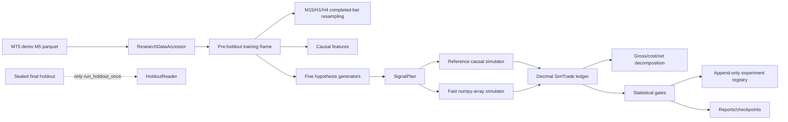

# Current Architecture

The current v4 pipeline is real for saved parquet inputs, but it is not yet a complete production research platform. The older `engine/` and `adapters/` tree coexists with v4 and contains simulated or incomplete paths. Those paths must not be confused with the v4 real-data path.

Important boundaries:

- Strategies generate proposals only.
- The v4 simulator is historical/backtest logic, not an order adapter.
- Holdout access is token- and lock-protected in `data/holdout.py`.
- No module may promote a strategy to `ACTIVE`.
