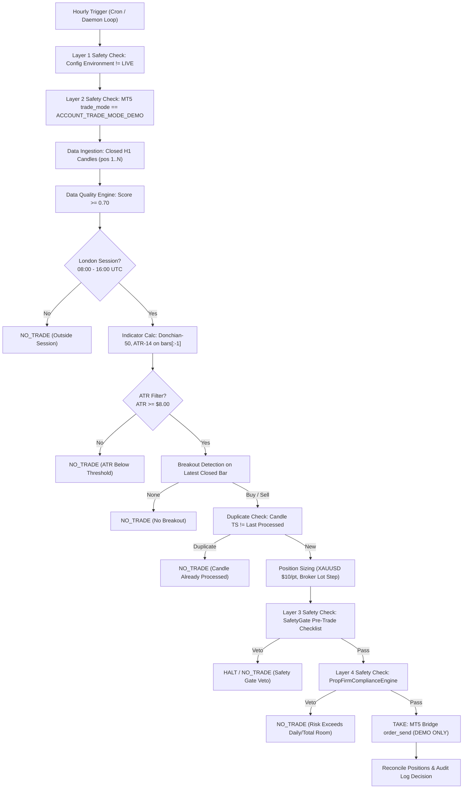

# Unified Quant Research Lab + MT5 Execution Architecture

## 1. Executive Summary

This document specifies the unified architecture resulting from merging:
1. **QT / Quant Trading Research Lab**: Multi-asset quantitative research, regime detection, walk-forward validation, statistical robustness tests (DSR, PSR, PBO, White's Reality Check), and deterministic risk engine.
2. **Donchian Model**: Systematic XAUUSD trend-following breakout strategy, MetaTrader 5 demo execution bridge, broker contract normalization, and automated operational reporting.
3. **FundingPips Prop Firm Compliance Engine**: Specialized compliance enforcement and research suite for FundingPips challenge models (2-Step Standard, 2-Step Pro, and 1-Step Flex).

---

## 2. Directory Structure and Module Origins

```
donchian_model/
├── configs/
│   ├── __init__.py                 # LabConfig, Environment enum (LIVE raises RuntimeError)
│   ├── config.yaml.example         # Base lab configuration template
│   └── fundingpips.yaml            # FundingPips challenge & risk configuration [NEW]
├── engine/
│   ├── safety_gate.py              # Pre-trade deterministic veto authority (A3/A7)
│   ├── risk_engine.py              # Position sizing, drawdown governor, kill switch
│   ├── regime.py                   # Market regime detection (ADX, ATR, MA structure)
│   ├── prop_firm_rules.py          # FundingPips rule profiles & claim statuses [NEW]
│   ├── prop_firm_compliance.py     # Deterministic compliance engine with UTC+3 reset [NEW]
│   ├── mt5_bridge.py               # MT5 demo bridge with account verification
│   ├── backtest_fixed.py           # Event-driven backtester with XAUUSD-accurate sizing
│   ├── prop_firm_research.py       # Prop-firm risk simulation and walk-forward engine
│   ├── validation.py               # DSR, PSR, PBO, combinatorial walk-forward CV
│   ├── validation_gates.py         # Promotion gates and statistical criteria
│   ├── data_quality.py             # Data quality evaluation (0.0 - 1.0)
│   └── logger.py                   # Structured JSON audit logger (AuditLogger)
├── data/
│   ├── storage.py                  # Parquet + DuckDB storage with SHA-256 hash
│   ├── fetch_extended.py           # Extended historical bars fetcher
│   └── store/max/
│       ├── XAUUSD_H1_MAX.parquet   # 50,000 bars (2018-03-26 to 2026-09-22)
│       ├── XAUUSD_H4_MAX.parquet   # 34,132 bars (2004-06-11 to 2026-09-22)
│       └── XAUUSD_D1_MAX.parquet   # 5,725 bars (2004-06-11 to 2026-09-22)
├── qt/                             # Prop firm research modules & reports
│   ├── propfirm_backtest.py        # M5 Donchian/MeanReversion simulation
│   └── fundingpips_research_v3/    # Multi-strategy research suite
├── tests/                          # Automated test suites (335+ tests passing)
│   ├── test_fundingpips_compliance.py  # Compliance engine tests [NEW]
│   ├── test_mt5_quant_algo.py          # Unified algorithm tests [NEW]
│   └── ...                         # Test suites for all engine components
├── mt5_quant_algo.py               # Primary unified operational entry point [NEW]
├── mt5_donchian_exec.py            # Legacy standalone MT5 execution script
├── daily_run.py                    # Daily execution pipeline runner
└── daily_report.py                 # Markdown & JSON daily report generator
```

---

## 3. End-to-End Decision & Execution Pipeline



---

## 4. Multi-Layer DEMO Enforcement (Absolute Zero-Live Mandate)

Per `AGENTS.md` A2, live capital trading is strictly forbidden:

1. **Config Layer (`configs/__init__.py`)**:
   `LabConfig.__post_init__` checks `Environment.is_live(self.environment)`. If `'LIVE'` or any case variation is detected, it raises `RuntimeError` and refuses to initialize.
2. **Algorithm Guard (`mt5_quant_algo.py`)**:
   `MT5QuantAlgorithm._enforce_demo_safety()` verifies `config.environment != 'LIVE'`.
3. **Bridge Inspection (`engine/mt5_bridge.py`)**:
   `MT5Bridge.connect()` and `verify_demo_mode()` inspect `account_info().trade_mode == ACCOUNT_TRADE_MODE_DEMO`. If live or unknown, orders are blocked and a critical security audit event is logged.
4. **Pre-Execution Check (`mt5_quant_algo.py`)**:
   `_verify_mt5_demo_mode()` checks `account_info().trade_mode == mt5.ACCOUNT_TRADE_MODE_DEMO` before every evaluation cycle. If terminal is disconnected, offline, or returns non-demo, state transitions to `HALT`.

---

## 5. FundingPips Compliance Engine

### UTC+3 Reset Mechanics
FundingPips resets daily limits at platform midnight, which is **UTC+3 (21:00 UTC)**:
$$\text{day\_id} = (\text{timestamp}_{\text{UTC}} - 21\text{ hours}).\text{date()}$$
This maps timestamps from 21:00 UTC on day $N$ to 20:59 UTC on day $N+1$ into day $N$.

### Daily Reference Equity
FundingPips defines the daily drawdown baseline as:
$$\text{Daily Reference} = \max(\text{Opening Balance}, \text{Opening Equity})$$
Both realized losses and floating (unrealized) drawdown consume daily room in real time.

### Supported Profiles and Claim Status (AGENTS.md A9)

| Profile ID | Model | Phase | Target | Max Daily | Max Total | Min Days | Claim Status |
|---|---|---|---|---|---|---|---|
| `fundingpips_2step_standard_5pct_p1` | 2-Step Standard | Phase 1 | 8% | 5% | 10% | 3 | **EMPIRICAL** |
| `fundingpips_2step_standard_5pct_p2` | 2-Step Standard | Phase 2 | 5% | 5% | 10% | 3 | **EMPIRICAL** |
| `fundingpips_2step_standard_3pct_p1` | 2-Step Standard (3% Add-on) | Phase 1 | 8% | 3% | 10% | 0 | **EMPIRICAL** |
| `fundingpips_2step_standard_3pct_p2` | 2-Step Standard (3% Add-on) | Phase 2 | 5% | 3% | 10% | 0 | **EMPIRICAL** |
| `fundingpips_2step_pro_p1` | 2-Step Pro | Phase 1 | 6% | 3% | 6% | 2 | **EMPIRICAL** |
| `fundingpips_2step_pro_p2` | 2-Step Pro | Phase 2 | 6% | 3% | 6% | 2 | **EMPIRICAL** |
| `fundingpips_1step_flex_p1` | 1-Step Flex | Phase 1 | 12% | 5% | 10% | 0 | **UNVERIFIED** (Execution Blocked) |

> [!IMPORTANT]
> Unverified rule profiles (such as 1-Step Flex) are blocked from trade execution by `PropFirmComplianceEngine` with `VerdictCode.UNVERIFIED_RULES` until verified against official documentation.

---

## 6. XAUUSD Contract & Position Sizing Specifications

- **Contract Size**: 100 troy ounces per lot.
- **Tick Size**: 0.01 USD.
- **Point Value**: $10.00 per 1.0 lot for a 0.01 price change.
- **Stop Loss Distance**: $\text{Stop Distance} = \text{ATR}_{14} \times 2.0$.
- **Risk Dollars**: $\text{Risk \$} = \text{Equity} \times 0.25\%$.
- **Lot Calculation**:
  $$\text{Lots} = \frac{\text{Risk \$}}{(\text{Stop Distance} / 0.01) \times \$10.00} = \frac{\text{Risk \$}}{\text{Stop Distance} \times 1000}$$
- **Broker Constraints**: Clamped to $[\text{volume\_min}, \text{volume\_max}]$ (typically $[0.01, 10.0]$ lots) and rounded to $\text{volume\_step}$ (0.01). If the minimum valid lot exceeds permitted risk, the order is rejected.

---

## 7. Strategy Invariants

1. **Closed Candles Only**: Signals are calculated strictly on completed bars. The bar being evaluated is never open.
2. **Lagged Channel Calculation**: Donchian channels and ATR are computed using the window preceding the evaluated bar: `bars[:-1]`.
3. **Session Filter**: Trading is allowed only between 08:00 UTC and 16:00 UTC (London session).
4. **ATR Minimum**: Volatility filter requiring $\text{ATR}_{14} \ge \$8.00$.
5. **No Duplicate Fills**: The algorithm records `_last_processed_bar_ts` to disk. Repeated hourly polls on the same closed bar produce `NO_TRADE (CANDLE_ALREADY_PROCESSED)`.
